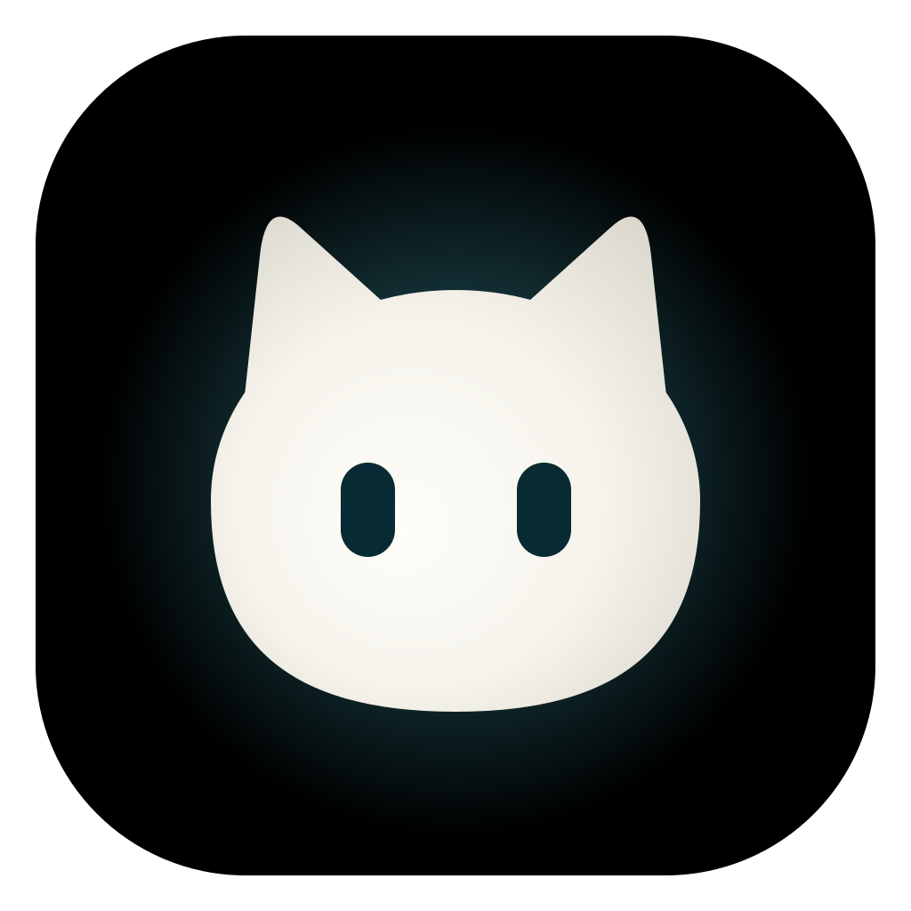
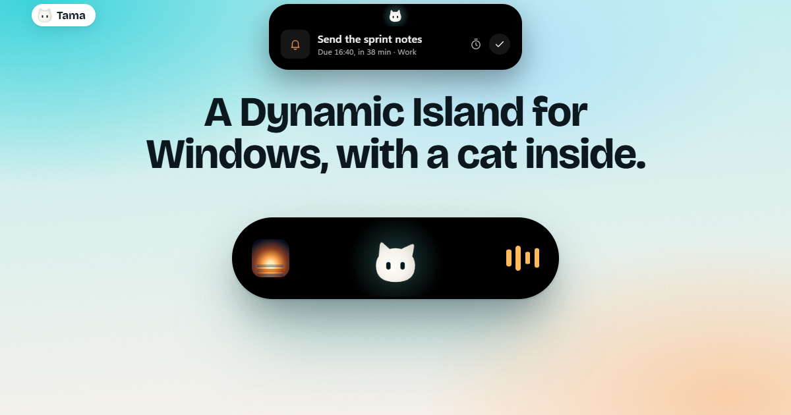
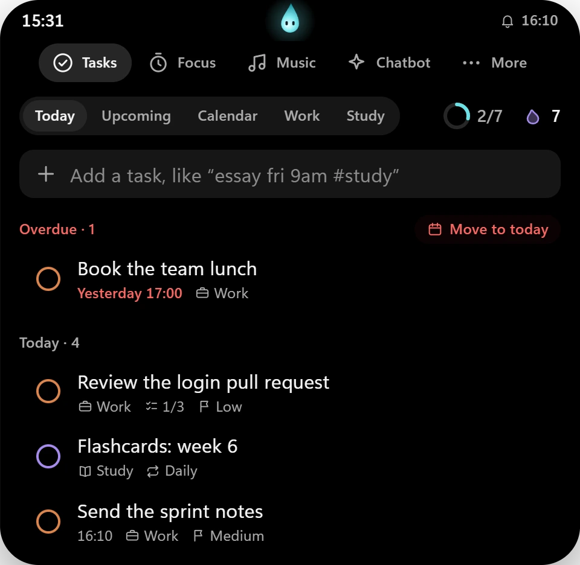
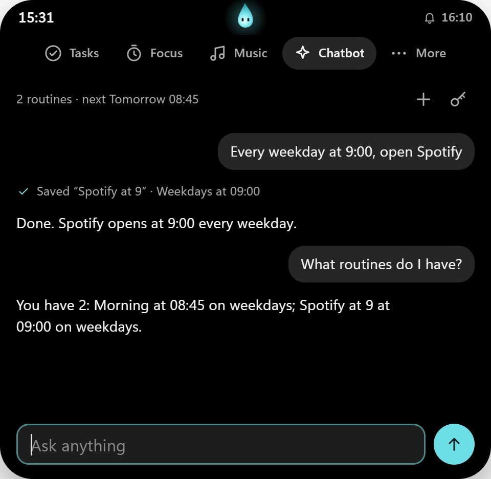
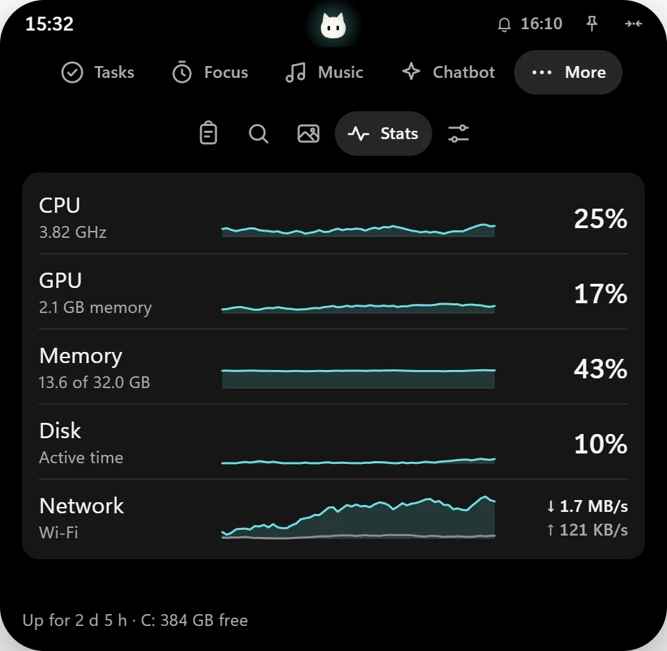

<div align="center">



# Tama

**A Dynamic Island for Windows.**

Tasks and reminders, a focus timer, now playing with synced lyrics and a chatbot that sets up routines,<br />
all in one black capsule at the top of your screen.

[](https://github.com/kylev202/Tama/releases/latest)
[](#install)
[](https://tauri.app/)
[](https://github.com/kylev202/Tama/releases/latest)
[](#licence)

**[Download](https://github.com/kylev202/Tama/releases/latest)** · **[Website and live demo](https://kylev202.github.io/Tama/)** · [Features](#features) · [Quick add](#quick-add) · [Build from source](#build-from-source)

<br />

<a href="https://kylev202.github.io/Tama/"></a>

</div>

## About

Tama puts a Dynamic Island at the top of your main screen, modelled on the island in [Hitodama](https://hitodama.in/). At rest it answers "what's happening now": the focus countdown, the song that's playing or the next thing due. Hover it for quick controls. Scroll down on it or click it to open the panels and plan your day.

Inside lives a small milky-white cat. It watches your cursor, blinks, closes its eyes while you focus, droops its ears late at night and celebrates when today's list is done. Left alone, it yawns, stretches, swishes its tail, washes a paw, chases a firefly and naps. With the cat off, a standby scene takes its place: a clock, rolling digits, an hourglass, a breathing orb or a small orbit.

- **Offline by default.** Only two things ever go online: song lyrics from [LRCLIB](https://lrclib.net/), which you can turn off, and the Chatbot, once you add your own free Groq API key.
- **Stays out of your way.** Clicks pass straight through around the capsule, it hides when an app goes fullscreen, and it only takes keyboard focus when you type into it.
- **Small.** A 1.5 MB installer that doesn't ask for admin rights.

## Features

<table>
  <tr>
    <td width="33%"></td>
    <td width="33%"></td>
    <td width="33%"></td>
  </tr>
  <tr>
    <td align="center"><b>Tasks</b><br />Plan the day without leaving the desktop</td>
    <td align="center"><b>Chatbot</b><br />Set up routines by asking</td>
    <td align="center"><b>Stats</b><br />Your PC, live, one glance</td>
  </tr>
</table>

| Panel | What it does |
|---|---|
| **Tasks** | Today, Upcoming (the next 7 days, by day) and a month Calendar of deadlines, plus Work and Study lists. Tasks can have steps, notes and a repeat (daily, weekdays, weekly, monthly). Overdue tasks move to today in one click. Progress ring, study streak, reminders |
| **Focus** | Pomodoro-style timer tied to a task; counts down live in the closed island |
| **Music** | Now playing from any app (Spotify, browser tabs, …) with play/pause/skip and a seek bar. Time-synced lyrics scroll with the song; tap a line to jump to it, scroll to read ahead. Hovering the island shows the line being sung |
| **Chatbot** | Chat with gpt-oss-120b (free, on Groq), which sets up your routines: at a time (some weekdays, or once), open apps and web pages. "Every weekday at 9:00, open Spotify", "move it to 8:30", "what routines do I have?", "run my morning routine now". Needs a free API key from [console.groq.com](https://console.groq.com/keys) |
| **More** | The desktop tools below, one section each |

Under **More**:

| Section | What it does |
|---|---|
| **Clipboard** | Recent text copies, in memory only; password-manager copies are skipped |
| **Launch** | Search your Start-menu apps or the web; pin favourites |
| **Wallpapers** | Pick a folder; click an image to set it on every monitor |
| **Stats** | Live CPU, GPU, memory, disk and network use, each with the last minute graphed, plus uptime, free space and battery. Sampled once a second only while it's open |
| **Settings** | Volume, dark mode, sounds, start with Windows, shortcuts into Windows Settings, and Personalise |

### How the island behaves

| State | What you see |
|---|---|
| **At&nbsp;rest** | The cat and whatever is live: the focus countdown, the song playing, or the next task due |
| **Hover** | Quick controls for what's live: previous, play/pause and next with the line being sung; pause or resume a focus session; or start focus on the next task and mark it done |
| **Open** | Scroll down on the island or click it. Arrow keys move between tabs; Esc closes it. The pin beside the date keeps it open while you work elsewhere |
| **Hidden** | The button beside the pin puts the island away as just the cat (or a small capsule with the standby scene). Alerts still come through; click it to bring the island back |
| **Alert** | It opens by itself when something needs an answer: a reminder (Snooze 10 min, Mark done) or the end of a focus session (Start a break, Not now) |

## Install

1. Download `Tama_1.1.0_x64-setup.exe` from [Releases](https://github.com/kylev202/Tama/releases/latest).
2. Run it. It installs for your account only, so it doesn't ask for admin rights.
3. If Windows SmartScreen says it protected your PC, choose **More info**, then **Run anyway**. Tama isn't code-signed yet, so Windows doesn't recognise it.
4. Look at the top of your main screen. Tama starts with Windows; turn that off in Settings or from the tray icon.

**Requirements:** Windows 11, 64-bit, and the WebView2 runtime, which Windows 11 already has.

## Quick add

Type a task and the details are picked out as you go:

| You type | Meaning |
|---|---|
| `#work` `#study` (`#w` `#s`) | Which list |
| `!` `!!` `!!!` or `!low` `!med` `!high` | Priority |
| `today` `tonight` `tomorrow` `fri` `next week` | Day |
| `9am` `3:30pm` `15:00` `15h30` `at 3` | Time (sets a reminder) |
| `in 30 min` `in 2 h` `in 3 days` | Relative |
| `daily` `every weekday` `weekly` `every fri` `monthly` | Repeat (finishing one schedules the next) |

Examples: `Essay draft fri 9am #study !high`, `Standup every weekday 9:30 #work`.

## Personalise

**Settings → Personalise** changes how Tama looks and behaves, and the island updates as you go:

- **Style:** Island (floats below the top edge), Notch (joined to the top edge) or Cat (only the cat until you hover). Three sizes. The cat can be hidden in the first two, and its antics turned off. With the cat off, pick a standby scene for its place: Clock, Digits, Hourglass, Breathe, Orbit or none.
- **Colour:** ten accents (the cat's glow takes the colour too), four themes (Black, Graphite, Midnight, Light) and a background (Glow, Aurora, Stars, Grain or the blurred album art).
- **Text:** Segoe UI, Bahnschrift, Sitka, Georgia or Cascadia, and the lyrics size.
- **Time and date:** 24 or 12-hour clock, seconds, a clock in the resting island, five date formats, and whether weeks start on Monday or Sunday.
- **Behaviour:** quick controls on hover, the lyric line on hover, and which tab the island opens to.

It also follows Windows' **Animation effects** setting: with it off, springs become short crossfades, the cat stops drifting and getting up to antics, and standby scenes hold still.

## Privacy and your data

- **Your tasks, routines, stats and settings:** the app's WebView2 storage in `%LOCALAPPDATA%\dev.tama.island`.
- **Clipboard history:** memory only; gone when Tama quits.
- **Lyrics:** looked up on LRCLIB with only the song's title, artist, album and length, then cached in `%LOCALAPPDATA%\dev.tama.island\lyrics`, so each song goes online once. Lyrics are on by default; the lyrics button in Music turns them off.
- **Chatbot:** your Groq API key is in Windows Credential Manager as `Tama/Groq API key` (the key button in the chat changes or removes it). What you type in the chat, your routines and the names of matching apps go to Groq's API (model `openai/gpt-oss-120b`); the conversation itself is kept in memory only and is gone when Tama quits. Without a key nothing is sent. Groq's free tier has per-minute and per-day limits; when one is reached the chat says how long to wait.
- **Start with Windows:** a `Tama` entry under `HKCU\Software\Microsoft\Windows\CurrentVersion\Run`. Turn it off from Settings in the island or the tray icon.
- **Uninstall:** Windows Settings → Apps → Installed apps → Tama.

## Build from source

You'll need [Node.js](https://nodejs.org/), [Rust](https://rustup.rs/) with the MSVC toolchain, and the WebView2 runtime (built into Windows 11).

```sh
git clone https://github.com/kylev202/Tama.git
cd Tama
npm install
npm run dev     # debug build with a console window
npm run build   # release build + installer in src-tauri/target/release/bundle/nsis
```

**Built with** [Tauri 2](https://tauri.app/) and Rust (the [`windows`](https://github.com/microsoft/windows-rs) crate for the media session, shell and system APIs) on the native side, and plain HTML, CSS and JavaScript in WebView2 on the front end, with no framework and no bundler.

### Project structure

```text
tama/
├── src/                  The island's front end
│   ├── index.html
│   ├── css/              Design tokens, base styles, the island and the panels
│   └── js/
│       ├── main.js       Wires the island together
│       ├── island.js     The capsule's states: rest, peek, open, alert
│       ├── cat.js        The cat, drawn procedurally on a canvas
│       ├── standby.js    The standby scenes in the cat's place when it's off
│       ├── live.js       What the closed island shows
│       ├── store.js      Tasks, routines, stats and settings
│       ├── parse.js      Quick add
│       └── panels/       One module per tab and section
├── src-tauri/            The native side
│   └── src/
│       ├── island.rs     The click-through window on the primary monitor's top edge
│       ├── media.rs      Now playing, from the Windows media session
│       ├── lyrics.rs     Lyrics from LRCLIB, cached on disk
│       ├── chat.rs       The Chatbot's model, on Groq
│       ├── scheduler.rs  Alarms for reminders, focus sessions and routines
│       ├── stats.rs      CPU, GPU, memory, disk, network and battery
│       └── …             Shell, clipboard, audio and system helpers
├── site/                 The website and its live demo
├── DESIGN.md             The design system: colour, type, components, motion
└── PRODUCT.md            Who Tama is for, and the principles behind it
```

### Website

The website is in `site/`. Its live demo is the app's own front end, run against `site/demo/bridge.js`, a stand-in for the Rust side that answers every command with demo data (the songs and lyrics are made up).

```sh
npm run site        # preview at http://localhost:5180/, straight from site/ and src/
npm run site:build  # the published version, in _site/
```

Opening `site/` with a plain static server (like Live Server) won't work: the demo is put together from `src/`. Pushing to `main` publishes the site to GitHub Pages (`.github/workflows/pages.yml`). If you add a native command, add it to `bridge.js` too, or the demo rejects it.

## Acknowledgements

- [Hitodama](https://hitodama.in/), whose island inspired Tama's.
- [LRCLIB](https://lrclib.net/), the free lyrics database behind synced lyrics.
- [Groq](https://groq.com/), whose free tier runs the Chatbot's model.
- [Tauri](https://tauri.app/), which makes a 1.5 MB Windows app possible.
- [Bricolage Grotesque](https://github.com/ateliertriay/bricolage) (SIL OFL), the website's headline typeface.

## Licence

© 2026 kylev202. All rights reserved. The source is public so you can read it and build it for yourself; it is not licensed for reuse or redistribution.
